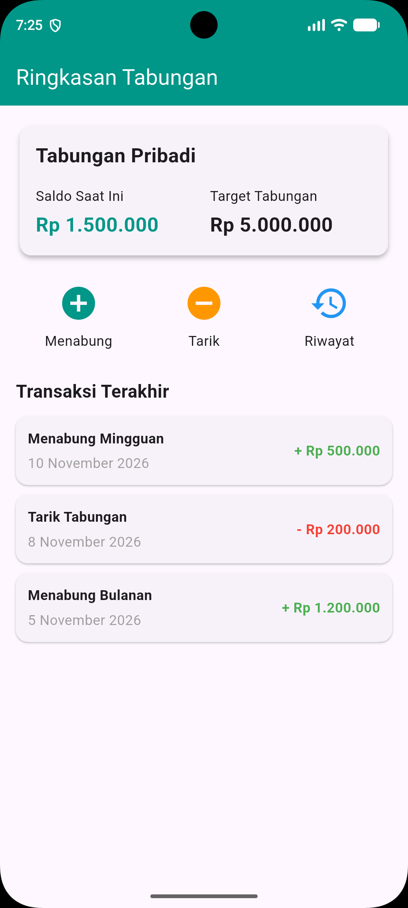
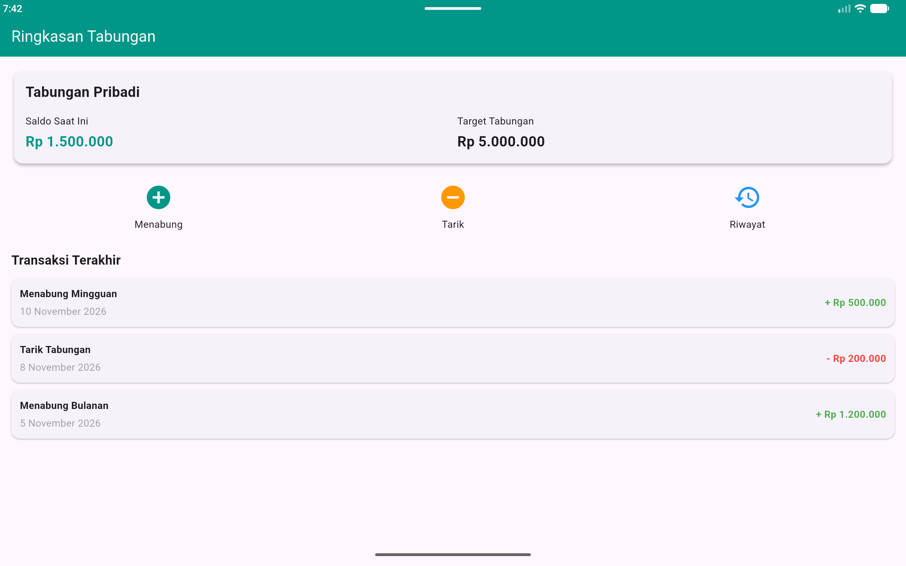

# TabungKu Layout

## Tugas Minggu 3 – Pemrograman Mobile

Aplikasi TabungKu Layout dibuat untuk memenuhi tugas menyusun layout menggunakan widget dasar Flutter. Aplikasi ini menampilkan ringkasan tabungan dan daftar transaksi sederhana.

## Identitas Mahasiswa

- Nama: Lingga Naura Rediana
- NIM: 20240801055
- Kelas: CR001
- Mata Kuliah: Pemrograman Mobile
- Universitas: Esa Unggul

## Fitur Aplikasi

1. Menampilkan kartu ringkasan tabungan yang berisi nama tabungan, saldo, dan target.
2. Menampilkan tiga ikon menu: Menabung, Tarik, dan Riwayat.
3. Menampilkan tiga transaksi terakhir lengkap dengan judul, tanggal, dan nominal.
4. Tampilan dapat digunakan pada ukuran layar HP dan tablet.

## Widget yang Digunakan

- Scaffold dan AppBar
- Card, Column, dan Row
- Padding dan SizedBox
- Text dan Icon
- Expanded dan FittedBox
- SingleChildScrollView

## Cara Menjalankan Aplikasi

1. Pastikan Flutter SDK dan Android Studio sudah terpasang.
2. Clone atau download repository ini.
3. Buka folder `tabungku_layout` di Android Studio.
4. Buka terminal pada folder project.
5. Jalankan perintah berikut untuk mengambil dependencies:

   flutter pub get

6. Jalankan emulator Android.
7. Jalankan aplikasi dengan perintah:

   flutter run

## Dokumentasi Tampilan

### Tampilan HP – Pixel 8

### Tampilan Tablet – Pixel Tablet

## Hasil Pengujian

Aplikasi berhasil dijalankan pada emulator Pixel 8 dan Pixel Tablet. Tampilan ringkasan tabungan, tiga ikon menu, serta daftar transaksi muncul dengan baik tanpa overflow yang terlihat.

Pemeriksaan menggunakan `flutter analyze` juga menghasilkan `No issues found!`.

## Keterangan

Aplikasi menggunakan widget bawaan Flutter tanpa menambahkan package pihak ketiga. Data transaksi dibuat secara statis untuk latihan menyusun layout.
